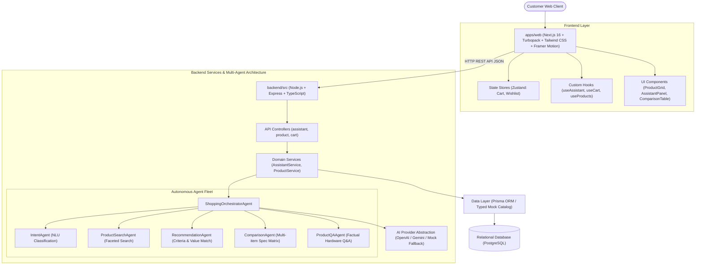

# ShopMind AI — Architecture & System Design
*Tagline: "Shopping, powered by intelligence."*

## 1. High-Level Architecture Topology



---

## 2. Directory & Monorepo Organization

```
Shopping_assistant/
├── apps/
│   ├── web/                     # Next.js 16 App Router web frontend
│   │   ├── src/
│   │   │   ├── app/             # App Router pages (/, /shop, /products, /assistant, /compare, /cart, /wishlist)
│   │   │   ├── components/      # UI primitives, home, products, assistant, compare, cart, layout
│   │   │   ├── data/            # 24+ structured Indian market mock products with INR pricing
│   │   │   ├── hooks/           # useAssistant, useCart, useWishlist, useProducts
│   │   │   ├── store/           # Persistent Zustand state stores
│   │   │   └── types/           # TypeScript interfaces for products, cart, assistant
│   │   └── package.json
│   └── mobile/                  # Cross-platform React Native / Expo workspace
├── backend/                     # Node.js Express TypeScript API
│   ├── src/
│   │   ├── agents/              # Multi-agent fleet (Orchestrator, Intent, Search, Rec, Comp, QA)
│   │   ├── config/              # Environment config and database connections
│   │   ├── controllers/         # Request handling and JSON validation
│   │   ├── data/                # In-memory product database with specs & sentiment
│   │   ├── middleware/          # Helmet, CORS, Morgan, Error handler, Zod validator
│   │   ├── routes/              # Express route declarations (assistant, products, cart, health)
│   │   ├── services/            # Core business logic and agent invocation
│   │   ├── types/               # Agent and domain model types
│   │   └── utils/               # Structured response formatter and logger
│   └── package.json
├── database/                    # Database migrations and models
│   ├── prisma/
│   │   └── schema.prisma        # Complete schema (User, Product, Category, Cart, Wishlist, Order, Review)
│   └── sql/                     # Seed and DDL scripts
├── packages/
│   ├── shared-types/            # Shared TypeScript domain contracts
│   ├── validation/              # Zod validation schemas
│   └── api-client/              # Unified API client
├── docs/                        # Technical documentation & design guides
└── README.md                    # Project overview & running instructions
```

---

## 3. Frontend Architecture

### Core Technologies
- **Next.js 16 (App Router + Turbopack)**: Server-side rendering, client components where interactive, dynamic route segment handling (`/products/[id]`).
- **Tailwind CSS & Vanilla Design Tokens**: Curated modern dark-mode-first aesthetic with slate palettes, violet/indigo gradients, and translucent glassmorphism cards.
- **Framer Motion**: Micro-interactions, spring-animated badges, smooth route transitions, and glowing AI orb hero visualizations.
- **Lucide Icons**: Crisp vector iconography across catalog filters, comparison markers, and chat messages.
- **Zustand**: Client-side state persistence (`localStorage`) for cart items, wishlist entries, and comparison selections.
- **Fault-Tolerant AI Concierge Hook (`useAssistant.ts`)**: Tries the backend API endpoint (`POST /api/assistant/chat`) and falls back seamlessly to client-side agent logic if the backend service is offline.

---

## 4. Backend & Multi-Agent Architecture

### Design Principles
1. **Separation of Concerns**: Controllers validate inputs, Services coordinate domains, Agents reason over constraints.
2. **Standardized Response Envelope**: Every HTTP response conforms to:
   ```json
   {
     "success": true,
     "message": "Operation description",
     "data": { ... }
   }
   ```
3. **Pluggable AI Provider**: `AIProvider` interface allows swapping between OpenAI GPT-4o, Google Gemini 2.0, Anthropic Claude, or local heuristics without altering agent logic.
4. **Resilient Natural Language Processing**: Heuristic intent classification and budget parsing extracts INR currency figures (e.g. `₹60,000`, `60000`, `60k`) and use cases (`coding`, `photography`, `gaming`, `battery`).

---

## 5. Security & Production Readiness
- **Helmet.js**: Sets security HTTP headers.
- **CORS**: Configurable domain whitelisting.
- **Input Validation**: Zod-based request schema validation.
- **Global Error Handling**: Centralized Express middleware catching uncaught exceptions and formatting friendly client errors.
